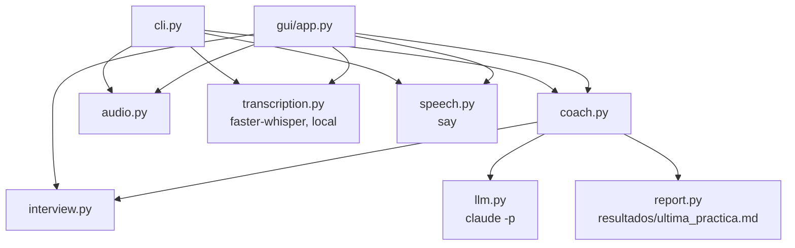

# Arquitectura

El proyecto es un paquete de Python, `src/interview_coach`, con dos interfaces que comparten la
misma lógica:

- `uv run practice`: una sola respuesta, en la terminal (`cli.py`).
- `uv run tutor`: una entrevista corta con el tutor, en una ventana (`gui/`).



## Módulos

| Módulo | Responsabilidad |
|---|---|
| `config.py` | Ajustes: modelo de Whisper, voz, archivo de resultado y turnos. |
| `prompts.py` | Las instrucciones de cada rol de la IA. |
| `interview.py` | Estado de la entrevista: mensajes, turnos y si ya terminó. |
| `coach.py` | Qué le pide a la IA: preguntas, correcciones, feedback y consejo. |
| `llm.py` | Acceso al modelo. `LLMClient` define la interfaz y `ClaudeCliClient` la implementa. |
| `speech.py` | Voz. `Speaker` define la interfaz y `MacSpeaker` la implementa con `say`. |
| `audio.py` | Grabación del micrófono. |
| `transcription.py` | Voz a texto con Whisper. |
| `report.py` | El Markdown del resultado. |
| `cli.py` | Interfaz de terminal. |
| `gui/app.py` | Ventana: reacciona a los eventos y coordina el resto. |
| `gui/widgets.py` | Componentes: selector de turnos, chat, correcciones y cuadro de respuesta. |
| `gui/theme.py` | Colores, tipografía y espacios, para modo claro y oscuro. |
| `gui/worker.py` | Ejecuta el trabajo lento en hilos. |

## Cómo extenderlo

Solo `cli.py` y `gui/` conocen la interfaz; el resto se puede usar y probar sin ella.

- **Otro proveedor de IA:** crea una clase con el método `complete` de `LLMClient` y pásala a `Coach`.
- **Otra voz, como un servicio de TTS:** crea una clase con los métodos de `Speaker` y pásala a `TutorApp`.
- **Otra interfaz, como una web:** usa `Coach` e `InterviewSession` directamente.
- **Un nuevo tipo de ayuda de la IA:** agrega su prompt a `prompts.py` y un método a `Coach`.

Las pruebas de `tests/` usan un `LLMClient` falso, así que no llaman a Claude ni usan el micrófono.

## Componentes

### `audio.py`
`Recorder` abre un `sounddevice.InputStream` mono a 16 kHz (la frecuencia que espera Whisper) y
acumula los bloques de audio en memoria entre `start()` y `stop()`. No escribe el audio a disco.
Una grabación de menos de un segundo se rechaza con un aviso.

### `transcription.py`
Usa [faster-whisper](https://github.com/SYSTRAN/faster-whisper) en CPU con cuantización
`int8`, así que funciona sin GPU y sin internet (salvo para descargar el modelo la
primera vez). Opciones relevantes:

- `language="en"` y modelos `.en`: más precisos que los multilingües para inglés.
- `vad_filter=True`: descarta los silencios.
- `condition_on_previous_text=False`: evita que Whisper use el texto anterior como
  contexto. Así "normaliza" menos lo que dijiste y más errores reales llegan a la
  corrección.

El modelo se carga una sola vez y se reutiliza entre turnos.

### `llm.py`
`ClaudeCliClient` llama al CLI de Claude Code en modo no interactivo y le pasa el mensaje por stdin:

```bash
claude -p --system-prompt "<SYSTEM_PROMPT>" --tools "" \
  --no-session-persistence --setting-sources ""
```

| Opción | Motivo |
|---|---|
| `-p` | Responde una vez y termina. |
| `--system-prompt` | Reemplaza el prompt de Claude Code por el del coach de inglés. |
| `--tools ""` | Sin herramientas: Claude solo puede responder con texto. |
| `--no-session-persistence` | No guarda la conversación en el historial de Claude Code. |
| `--setting-sources ""` | No carga la configuración de usuario ni de proyecto. |

Además se ejecuta con `cwd` en el directorio temporal del sistema, para que no tome
contexto del repositorio.

### `report.py`
Escribe el Markdown final en `REPORT_FILE` y sobrescribe el anterior. El contenido del resultado
sigue en español porque es para quien aprende: por eso sus títulos no están en inglés.

### Consejo hablado
`Coach.spoken_advice` pide, con `SPOKEN_ADVICE_PROMPT`, una recomendación breve en inglés, y
`MacSpeaker` la lee con la voz `TUTOR_VOICE`. No se guarda en el Markdown. Es opcional, así que
si falla, la práctica termina con normalidad.

### La entrevista en la ventana
Cada respuesta inicia dos llamadas a Claude en paralelo: la siguiente pregunta, con
`INTERVIEWER_PROMPT`, y las correcciones de esa respuesta, con `TURN_CORRECTION_PROMPT`. Por eso la
entrevista no espera a las correcciones. Al completar los turnos elegidos, `Coach.conclude_interview`
pide el feedback con `FEEDBACK_PROMPT`, guarda el resultado y prepara el consejo final.

Claude no guarda sesión entre llamadas, así que en cada turno recibe la conversación completa.

Las tareas lentas corren en hilos, y solo el hilo de Tkinter toca la ventana: `BackgroundTasks` deja
los resultados en una cola que la ventana revisa cada 100 ms. La voz del tutor se detiene al grabar,
para que el micrófono no la capte.

## Decisiones de diseño

| Decisión | Alternativa descartada | Por qué |
|---|---|---|
| Transcripción local con Whisper | API de transcripción en la nube | Gratis, privada y precisa con acento hispano. |
| Claude Code (`claude -p`) para corregir | API de Anthropic con el SDK `anthropic` | No requiere API key: usa la suscripción existente. |
| | Modelo local con Ollama | En un Intel sin GPU cada corrección tardaría minutos, con peor calidad; además Ollama no arrancaba en esta máquina. |
| | LanguageTool | Solo corrige gramática; no evalúa naturalidad ni reescribe la respuesta. |
| Un solo archivo de resultado | Un archivo por sesión con fecha | Evita acumular archivos. |
| Paquete en `src/` con módulos por responsabilidad | Un script por interfaz | La lógica no depende de la interfaz: se puede probar sola y agregar otra interfaz sin duplicarla. |
| CustomTkinter para la ventana | Tkinter puro; página web con Gradio | Da un aspecto moderno y modo oscuro sin navegador, con una dependencia pequeña. |

## Dependencias

Definidas en `pyproject.toml` y fijadas en `uv.lock`:

| Paquete | Uso |
|---|---|
| `sounddevice` | Captura del micrófono (usa PortAudio). |
| `numpy` | Buffer de audio. |
| `faster-whisper` | Transcripción (trae `ctranslate2` y `onnxruntime`). |
| `customtkinter` | Controles modernos de la ventana, sobre Tkinter. |

`pyproject.toml` incluye `tool.uv.required-environments` para macOS Intel (x86_64): las
versiones recientes de `onnxruntime` ya no publican wheels para esa plataforma, y así uv
elige una versión que sí los tiene (1.23.2).

## Estructura del repositorio

```text
.
├── src/interview_coach/          # El código
│   └── gui/                      # La ventana
├── tests/                        # Pruebas (uv run pytest)
├── pyproject.toml / uv.lock      # Dependencias y comandos
├── .claude/skills/               # Skills de Claude Code
│   ├── descripcion-pr/SKILL.md
│   ├── pregunta-entrevista/SKILL.md
│   └── repasar-practica/SKILL.md
├── docs/                         # Esta documentación
└── resultados/                   # Se crea al practicar (ignorado por git)
    └── ultima_practica.md
```
