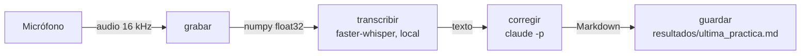

# Arquitectura

El proyecto es un único script, `practicar.py`, con cuatro pasos en secuencia.



## Componentes

### `grabar()`
Abre un `sounddevice.InputStream` mono a 16 kHz (la frecuencia que espera Whisper) y
acumula los bloques de audio en memoria entre dos pulsaciones de Enter. No escribe el
audio a disco. Si la grabación dura menos de un segundo, `main()` termina con un aviso.

### `transcribir(audio)`
Usa [faster-whisper](https://github.com/SYSTRAN/faster-whisper) en CPU con cuantización
`int8`, así que funciona sin GPU y sin internet (salvo para descargar el modelo la
primera vez). Opciones relevantes:

- `language="en"` y modelos `.en`: más precisos que los multilingües para inglés.
- `vad_filter=True`: descarta los silencios.
- `condition_on_previous_text=False`: evita que Whisper use el texto anterior como
  contexto. Así "normaliza" menos lo que dijiste y más errores reales llegan a la
  corrección.

### `corregir(transcripcion, pregunta)`
Llama al CLI de Claude Code en modo no interactivo y le pasa la transcripción por stdin:

```bash
claude -p --system-prompt "<SYSTEM_PROMPT>" --tools "" \
  --no-session-persistence --setting-sources ""
```

| Opción | Motivo |
|---|---|
| `-p` | Responde una vez y termina. |
| `--system-prompt` | Reemplaza el prompt de Claude Code por el del coach de inglés. |
| `--tools ""` | Sin herramientas: Claude solo puede responder con texto. |
| `--no-session-persistence` | No guarda la conversación en el historial de Claude Code. |
| `--setting-sources ""` | No carga la configuración de usuario ni de proyecto. |

Además se ejecuta con `cwd` en el directorio temporal del sistema, para que no tome
contexto del repositorio.

### `guardar(transcripcion, correcciones, pregunta)`
Escribe el Markdown final en `RESULT_FILE` y sobrescribe el anterior.

## Decisiones de diseño

| Decisión | Alternativa descartada | Por qué |
|---|---|---|
| Transcripción local con Whisper | API de transcripción en la nube | Gratis, privada y precisa con acento hispano. |
| Claude Code (`claude -p`) para corregir | API de Anthropic con el SDK `anthropic` | No requiere API key: usa la suscripción existente. |
| | Modelo local con Ollama | En un Intel sin GPU cada corrección tardaría minutos, con peor calidad; además Ollama no arrancaba en esta máquina. |
| | LanguageTool | Solo corrige gramática; no evalúa naturalidad ni reescribe la respuesta. |
| Un solo archivo de resultado | Un archivo por sesión con fecha | Evita acumular archivos. |
| Script único sin paquete | Paquete en `src/` | Es un MVP; un archivo es más fácil de leer y modificar. |

## Dependencias

Definidas en `pyproject.toml` y fijadas en `uv.lock`:

| Paquete | Uso |
|---|---|
| `sounddevice` | Captura del micrófono (usa PortAudio). |
| `numpy` | Buffer de audio. |
| `faster-whisper` | Transcripción (trae `ctranslate2` y `onnxruntime`). |

`pyproject.toml` incluye `tool.uv.required-environments` para macOS Intel (x86_64): las
versiones recientes de `onnxruntime` ya no publican wheels para esa plataforma, y así uv
elige una versión que sí los tiene (1.23.2).

## Estructura del repositorio

```text
.
├── practicar.py                  # El script
├── pyproject.toml / uv.lock      # Dependencias
├── .claude/skills/               # Skills de Claude Code
│   ├── pregunta-entrevista/SKILL.md
│   └── repasar-practica/SKILL.md
├── docs/                         # Esta documentación
└── resultados/                   # Se crea al practicar (ignorado por git)
    └── ultima_practica.md
```
